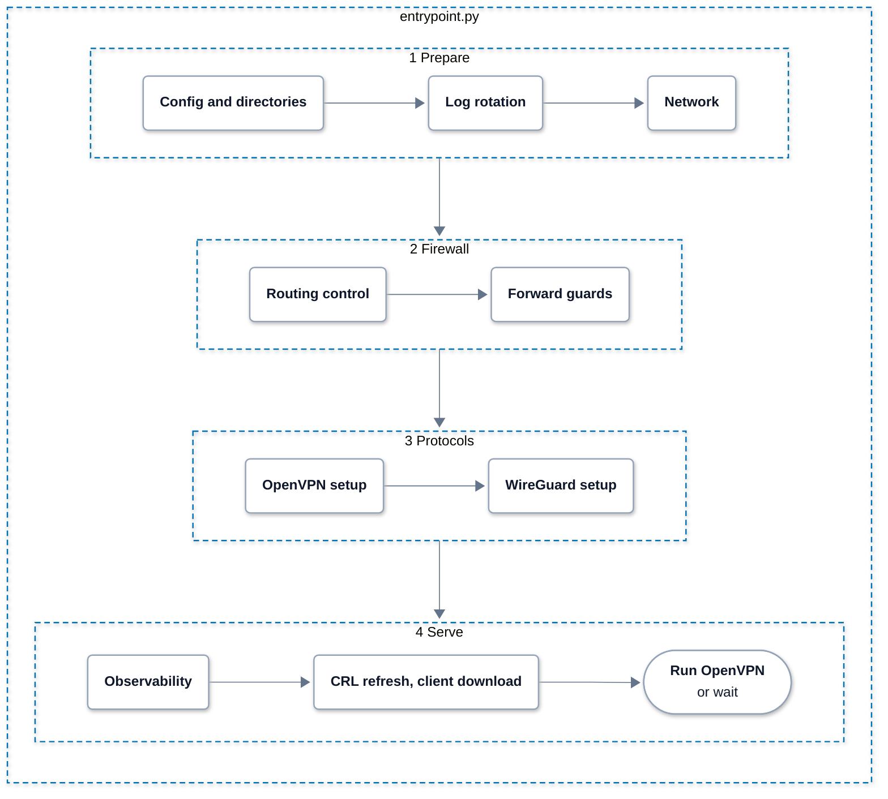

# Contributing

We welcome contributions to this project. By contributing, you agree to the
terms outlined below.

## Commit Message Format

HyperI projects use [Conventional Commits](https://www.conventionalcommits.org/)
and [semantic-release](https://semantic-release.gitbook.io/) for automated
versioning and changelog generation. All commits must follow this format:

```text
<type>(<scope>): <subject>

[optional body]

[optional footer(s)]
```

Each type sets the version bump:

| Type | Description | Version Bump |
|------|-------------|--------------|
| `feat` | A new feature | Minor (0.X.0) |
| `fix` | A bug fix | Patch (0.0.X) |
| `docs` | Documentation only | None |
| `style` | Code style (formatting, semicolons, etc.) | None |
| `refactor` | Code change that neither fixes a bug nor adds a feature | None |
| `perf` | Performance improvement | Patch (0.0.X) |
| `test` | Adding or correcting tests | None |
| `build` | Changes to build system or dependencies | None |
| `ci` | Changes to CI configuration | None |
| `chore` | Other changes that don't modify src or test files | None |
| `revert` | Reverts a previous commit | Varies |

For breaking changes that require a major version bump, add `!` after the type
or include `BREAKING CHANGE:` in the footer:

```text
feat!: remove deprecated API endpoints

BREAKING CHANGE: The /v1/users endpoint has been removed. Use /v2/users instead.
```

Examples:

```text
feat(auth): add OAuth2 support for Google login

fix(api): handle null response from upstream service

docs: update installation instructions for Windows

refactor(core)!: restructure module exports

BREAKING CHANGE: Named exports are now used instead of default exports.
```

The scope is optional but recommended. Use it to indicate the area of the codebase
affected (e.g., `api`, `auth`, `core`, `cli`, `docs`).

This project follows [Semantic Versioning 2.0.0](https://semver.org/):

- MAJOR (X.0.0): Breaking changes that require users to modify their code
- MINOR (0.X.0): New features that are backwards-compatible
- PATCH (0.0.X): Bug fixes and minor improvements

Versions are automatically determined by semantic-release based on commit
messages. Do not manually update version numbers.

## Developer Certificate of Origin

This project uses the Developer Certificate of Origin (DCO): every
contributor certifies they have the right to submit their contribution.

By making a contribution to this project, you certify that:

1. The contribution was created in whole or in part by you and you have the
   right to submit it under the license indicated in the file, or

2. The contribution is based upon previous work that, to the best of your
   knowledge, is covered under an appropriate open source license and you
   have the right under that license to submit that work with modifications,
   or

3. The contribution was provided directly to me by some other person who
   certified (1), (2) or (3) and you have not modified it.

4. You understand and agree that this project and the contribution are public
   and that a record of the contribution (including all personal information
   you submit with it, including your sign-off) is maintained indefinitely
   and may be redistributed consistent with this project or the license(s)
   involved.

You must sign off each commit to indicate your acceptance of the DCO. Combine
the signoff with your conventional commit message:

```bash
git commit --signoff -m "feat(auth): add two-factor authentication"
```

This produces:

```text
feat(auth): add two-factor authentication

Signed-off-by: Your Name <your.email@example.com>
```

Make sure your Git configuration has your correct name and email:

```bash
git config --global user.name "Your Name"
git config --global user.email "your.email@example.com"
```

All contributions to this project are licensed under the Apache License,
Version 2.0, the same license that covers the project (inbound = outbound).

## How to Contribute

1. Fork the repository and create your branch from `main`
2. Make your changes following the commit message format above
3. Sign off your commits with the DCO
4. Test your changes to check they work as expected
5. Submit a pull request with a clear description of what you've done

Before you open the pull request:

- [ ] Commits follow the conventional commit format
- [ ] All commits are signed off (DCO)
- [ ] Tests pass (if applicable)
- [ ] Documentation is updated (if applicable)

Run the checks locally before you push. HyperI projects gate every push through CI (lint, format, tests, secret scan,
dependency audit, build). Run the SAME checks locally first so CI does not bounce
your change:

```bash
hyperi-ci check
```

`hyperi-ci` is the HyperI CI CLI (public on PyPI). If you do not have it, install
it once with `uv tool install hyperi-ci` (or `pipx install hyperi-ci`), or run it
ad hoc with `uvx hyperi-ci check`. It runs the project's full local validation --
the same suite CI runs -- and reports what to fix. Run it before every push and before opening a
pull request. It is the single best way to give your change the best chance of
surviving CI.

## CI/CD Workflow

Every push and pull request runs the full CI pipeline - lint, format, tests,
secret scan, dependency audit, and a container build - through the shared
hyperi-ci reusable workflow.

Publishing is deliberate, not a side effect of merging. A plain merge to
`main` is a validate-only run: it does not tag or publish. A release happens
when the head commit on `main` has a `Release: true` trailer, or when
the workflow is dispatched by hand (Actions -> CI -> Run workflow, with
`from-head=true`). On a publish run, semantic-release reads the commits since
the last release, works out the next version from their types, updates the
CHANGELOG, tags a GitHub release, and pushes the multi-arch image to GHCR.

So land your change with a normal `fix:`/`feat:` merge, then trigger the
publish separately when you want it shipped.

## culvert Conventions

All runtime configuration is namespaced under `CULVERT_*` and is
read by `scalo` through its cascade (env -> `.env` -> a profile ->
`settings.{env}.yaml` -> `settings.yaml` -> `defaults.yaml` ->
hard-coded), the profile YAML loaded when `CULVERT_PROFILE` names one.
When adding a config field:

- Add it to `scripts/lib/config.py` as a dataclass attribute with a
  sensible generic default (`""` or `0`, never a HyperI-specific value).
- Put validation rules in its `validate()` method.
- Update `.env.example` with the variable name (prefixed
  `CULVERT_`) and quoted value (empty string is fine for defaults).
- Add a unit test in `tests/unit/test_config.py` that asserts the
  default and any validation behaviour.

Site-specific defaults ship as YAML files under `profiles/` and load
opt-in via `CULVERT_PROFILE=/etc/vpn/profiles/<name>.yaml`. The
shipped `example.yaml` profile is a placeholder template. Copy it and
edit the values for your site profile. Env vars always override
profile values.

Config templates under `config/*.template` use envsubst-style
`${VAR}` placeholders, and `scripts/lib/openvpn.py` or
`scripts/lib/stunnel.py` fills in each one. Wire a placeholder through one of
them before you add it to a template.

Questions about contributing go in an issue.

## Context

### What this is

A VPN server shipped as one container image. Python inside, but not a Python
package -- the PyPI publish is opted out and a wheel is built for pipeline
parity alone. Anyone deploys it, so defaults are generic and anything specific to one site
belongs in a profile or the deployment values. It replaced dfe-vpn, which is
retired, so older references to that repo are stale.

### Where things live

| Path | What it holds |
|---|---|
| `scripts/entrypoint.py` | Thin orchestrator. Owns the startup ORDER |
| `scripts/lib/` | One module per concern -- config, network, pki, openvpn, wireguard, stunnel, wstunnel, oauth2, health, metrics, process, download |
| `config/*.template` | `${VAR}` templates rendered at runtime |
| `profiles/` | Opt-in site presets loaded by `CULVERT_PROFILE` |
| `deploy/` | Deployment contract and compose fragment, GENERATED by `scripts/generate-deploy-artefacts.py`. The Helm chart is assembled from the contract at release and committed nowhere |
| `docs/architecture.md` | The components, what they depend on, and why it's one container. The startup order and invariants are below |

### Commands that test a change

`hyperi-ci check` locally, `tests/run-all.sh` for the tiers.

A passing CI run covers the UNIT tier alone, with coverage of `scripts/` held to hyperi-ci's default 80% floor. `.hyperi-ci.yaml` disables integration, e2e and k8s and leaves `ty` non-blocking. Run the rest yourself:

```bash
pytest tests/e2e/ -m e2e -v     # needs Docker and TUN
pytest tests/k8s/ -m k8s -v     # needs a kubeconfig and CULVERT_K8S_*
```

`addopts` has no `-m "not e2e"`, so a bare `pytest` tries the e2e tier and
fails without Docker rather than skipping.

### What tends to bite

| Don't | Do | Why |
|---|---|---|
| Write the skip-CI marker literally in a commit message | Describe it | GitHub scans the whole message, body included, so a literal marker anywhere in it gives the PR no CI run at all |
| Hand-edit `deploy/deployment-contract.json` or `deploy/compose/culvert.yaml` | Re-run `scripts/generate-deploy-artefacts.py` | Both render from the scalo deployment contract in `scripts/lib/deployment.py`, and a unit test compares the committed output against a fresh render |
| Call `easyrsa init-pki` | Create the directories directly, as `scripts/lib/pki.py` does | On 3.2.x it removes the PKI directory unconditionally. That is a volume mount, so it fails outright, and where it succeeds it takes the CA ([issue #11](https://github.com/hyperi-io/culvert/issues/11)) |
| Check a renamed doc's links on macOS | Let `tests/unit/test_docs_links.py` do it | It compares against `git ls-files`, so case matters. Every doc has to be linked from `docs/README.md`, which the same test checks |
| Read a passing PR as proof the image runs | Confirm the Container job built | The Container job is the one that starts the image, so a base-image bump or a broken config can pass every other check and die at startup |

### Startup order

`scripts/entrypoint.py` owns the order and nothing else. Every piece of work lives in a module under `scripts/lib/`. Network and firewall come up before either VPN.



*Figure 1. L4 Detail -- Startup sequence. Read each stage left to right, then down.* Up: [L3 Components -- culvert](docs/architecture.md).

The OpenVPN branch initialises PKI, renders the UDP, HTTPS and TCP server configs from `config/*.template`, sets up stunnel, generates any auto-clients and starts the OIDC helper. The WireGuard branch brings up `wg0` through `wg-quick`, starts wstunnel and starts a connection monitor. `both` runs both branches in full.

In WireGuard-only mode there is no OpenVPN process to block on, so the entrypoint marks itself started and ready and waits on signals. The kernel interface is up by then, which is why readiness flips there and not in the server starter.

### PKI invariants

- `easyrsa init-pki` is never called. It creates three directories and insists on removing the PKI directory first, unconditionally on 3.2.x. That directory is a volume mount, so the removal fails, and where it could succeed it would take the CA and every certificate. 3.1.x's `init-pki soft` isn't a substitute, because 3.2.x reads that argument as a curve name. Culvert creates the directories itself, and `build-ca` won't overwrite an existing CA, so a half-built PKI fails loudly.
- The `tls-crypt-v2` server key is minted locally unless a provider supplies one. A client's key derives from it, so two servers with different keys reject each other's clients. Once `CULVERT_SECRETS_TC_KEY_PATH` is set, a failed fetch is fatal, not a fall back to minting.
- CRL refresh differs by mode. Local PKI regenerates from its CA. External PKI has no CA key, so it re-fetches. OpenVPN re-reads the CRL on every handshake, so a changed file needs no reload. The server reloads when the fetched CRL revokes a certificate the old one didn't, to end that session before it renegotiates, and the reload drops every connected client.

### iptables ordering

NAT and MSS clamping go in the base `FORWARD` and `POSTROUTING` paths. Every policy rule lives in `CULVERT_FWD` (opt-in routing control: isolation, the egress allow-list, the downstream-admin gate) or `CULVERT_GUARD` (always on: drops forwarded traffic to link-local). Both are rebuilt on each start, so restarts can't stack duplicates.

1. `CULVERT_GUARD` is installed after `CULVERT_FWD`. Both insert at `FORWARD` position 1, so the last one installed is evaluated first, and the guard has to be.
2. `CULVERT_FWD` is detached from `FORWARD` before it is flushed, built completely, and jumped last. A flushed chain that is still jumped falls through to the `FORWARD` policy.
3. Client-to-client rules sit above the conntrack accept, so cross-tunnel traffic is decided without state and a RELATED packet can't slip between clients.
4. Reverse-admin replies get a NAT `RETURN`, scoped to established flows. Without it the masquerade rewrites the client's reply to the server's address. The scope keeps a client that initiates towards the admin range masqueraded.

A failed rule install raises and the container exits. Chain creation and rule deletion stay tolerant, because both fail on a normal restart. The tunnels are IPv4 and `net.ipv4.ip_forward` is the one forwarding sysctl set, so there's no ip6tables setup.

### Other invariants

- Configuration is `CULVERT_*` environment variables through scalo's cascade, with profile YAML as an extra source. Explicit env beats a profile.
- `/etc/vpn` and `/var/log/vpn` are the canonical paths and nothing aliases them. The OpenVPN package ships its paths as directories, so a symlink lands inside one and the PKI stops persisting.
- Defaults are generic. Anything specific to one site belongs in a profile or the deployment values.

### Where this sits

Inbound: **hyperi-io/scalo-py**, the one suite edge. `pyproject.toml` declares
`scalo[metrics,secrets-vault,secrets-aws]` bounded below 3 at runtime, plus a
dev-group `scalo[deployment]` range the artefact generators need and the runtime
never imports. Granular extras on purpose.

Outbound: nothing in the suite graph consumes culvert, and it is an optional
member. It reaches consumers as a public container image on GHCR.
