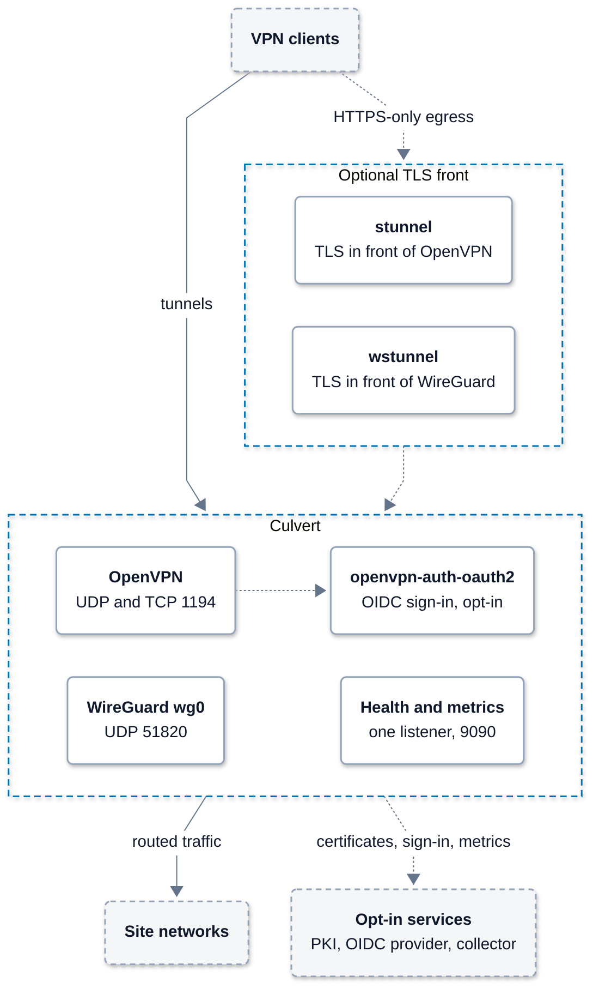

# culvert architecture

Culvert is a VPN server in one container: OpenVPN and WireGuard, configured by environment variable, with every capability past plain OpenVPN over UDP an explicit opt-in. In DFE it's the optional edge VPN that appliances dial into, and it stands alone anywhere else.

*Figure 1. L3 Components -- culvert. Dashed boxes are external, and dotted arrows are opt-in.* Up: top of culvert. Down: [L4 Detail -- Edge fleet traffic](use-case-edge-fleet.md#reverse-admin-and-cgnat-addressing).

## How data flows

1. A client on an open network dials OpenVPN or WireGuard. Behind HTTPS-only egress it dials stunnel or wstunnel on a TLS port, and they unwrap the session inside the container.
2. With OIDC on, OpenVPN hands each sign-in to openvpn-auth-oauth2, which sends the user to your OIDC provider before the tunnel opens.
3. The server routes client traffic to the site networks. Two iptables chains decide what a client may reach on the way.
4. Certificates come from local disk. In external mode a provider refreshes that disk, and culvert keeps serving on the cached files when the provider is down.
5. One listener serves `/livez`, `/readyz` and, when metrics are on, `/metrics`. OTLP is a push, so it adds no listener.

## Components

| Part | Port | Runs when | Its page |
|---|---|---|---|
| OpenVPN | `1194/udp`, `1194/tcp` | `CULVERT_PROTOCOL` is `openvpn` (the default) or `both`. UDP while `CULVERT_UDP_ENABLED` is true (the default), TCP once `CULVERT_TCP_ENABLED=true` | [Client setup](vpn-client-setup.md) |
| stunnel | `443/tcp` | OpenVPN runs and `CULVERT_HTTPS_ENABLED=true` | [Travel](use-case-travel.md) |
| openvpn-auth-oauth2 | `9000-9002/tcp` | one per OpenVPN listener with its `CULVERT_OAUTH2_*_ENABLED` true, each defaulting to `CULVERT_OAUTH2_ENABLED` | [Corporate](use-case-corporate.md) |
| WireGuard wg0 | `51820/udp` | `CULVERT_PROTOCOL` is `wireguard` or `both` | [Client setup](vpn-client-setup.md) |
| wstunnel | `4443/tcp` | WireGuard runs and `CULVERT_WG_HTTPS_TUNNEL_ENABLED=true` | [Travel](use-case-travel.md) |
| Health and metrics | `9090/tcp` | always, with `/metrics` once `CULVERT_METRICS_ENABLED=true` | [Kubernetes](use-case-kubernetes.md) |

## External dependencies

| Dependency | Needed | Choices |
|---|---|---|
| A TUN device and `NET_ADMIN` | always | the host's |
| Site networks | always | whatever the routes and `CULVERT_*` routing settings name |
| PKI | always | local Easy-RSA, or external through scalo secrets: a file mount, OpenBao or AWS Secrets Manager |
| OIDC provider | with `CULVERT_OAUTH2_ENABLED` | any OIDC provider |
| Metrics collector | with metrics on | Prometheus scrape, or OTLP push with `CULVERT_OTEL_ENABLED` and `CULVERT_OTEL_ENDPOINT` |
| `ovpn` kernel module | for DCO, optional | the host's: in Linux from 6.16, ovpn-backports on older kernels ([performance](performance.md)) |

## Deployment variants

- `docker run` with a TUN device is the five-minute start in the [README](../README.md).
- A `CULVERT_PROFILE` preset sets a site up in one go: `home`, `corporate`, `travel`, `edge-fleet` or `mobile`. Explicit env always beats a profile.
- The Helm chart runs one replica. WireGuard mints its server key in the pod and the PKI volume is ReadWriteOnce ([Kubernetes](use-case-kubernetes.md)).
- Several OpenVPN instances can share one PKI volume under the compose overlay, with limits ([shared storage](shared-storage.md)).

## Design considerations

**Security.** `CULVERT_GUARD` drops forwarded client traffic to link-local on every configuration, which on a cloud instance is the metadata service and its credentials. It guards `FORWARD` alone, so the server's own access to that service still works for external PKI on AWS. Routing control, client isolation and the egress allow-list are opt-in in `CULVERT_FWD`. The OpenVPN path ships the CNSA 2.0 classical suite ([cryptography](cryptography.md)).

**Reliability.** A control the config asks for that fails to install stops the container. Serving clients while reporting a control that isn't there is the outcome being avoided. A CRL past its `nextUpdate` makes OpenVPN refuse every client, so the refresher reports remaining life on every cycle.

**Operations.** Upgrading is a `docker pull`. Health and metrics share one port, so one published port covers the operator surface and none of it rides on a VPN listener.

**Performance.** AES-256-GCM is the default and ChaCha20 is offered. DCO moves the data path into the kernel where the host has the module ([performance](performance.md)).

## Why it's built this way

**One container, no control plane.** A VPN server is easy to install and hard to keep correct. Host scripts drift, and a management plane adds a database and a web UI to configure one daemon. With no state store, a replica is defined by its environment and volumes alone.

**Local disk is the PKI's source of truth.** In both modes OpenVPN reads the files under the PKI directory, and a remote provider is how they get updated, not the authority. That's what keeps an external deployment serving when the provider is unreachable.

**OpenVPN 2.7 or later.** The server config depends on 2.7 behaviour. 2.7 deprecates `persist-key` on the server, and its clients reject an unknown pushed option, which is why `block-outside-dns` isn't pushed. The build fails on an older package ([supply chain](supply-chain.md)).

**No kernel module in the image.** DKMS inside a container would compile against headers that aren't there, and the module has to be on the host anyway. Leaving it out drops a compiler toolchain from the image.

**Generated deployment files.** `deploy/` and the release's Helm chart render from culvert's scalo deployment contract, so the chart can't drift from the image it deploys.

## Diagram map

- [Figure 1. L3 Components -- culvert](#culvert-architecture)
  - [L4 Detail -- Edge fleet traffic](use-case-edge-fleet.md#reverse-admin-and-cgnat-addressing)
  - [L4 Detail -- Startup sequence](../CONTRIBUTING.md#startup-order), for contributors

## What's next

- Run it: the [README](../README.md) quick start, then a walkthrough from [the docs index](README.md#pick-a-deployment).
- Every setting: the README's configuration section.
- What's in the image and how the build checks it: [supply chain](supply-chain.md).
- Change culvert: the Context section of [CONTRIBUTING.md](../CONTRIBUTING.md#context), which has the startup order, the iptables ordering rules and the PKI invariants.
