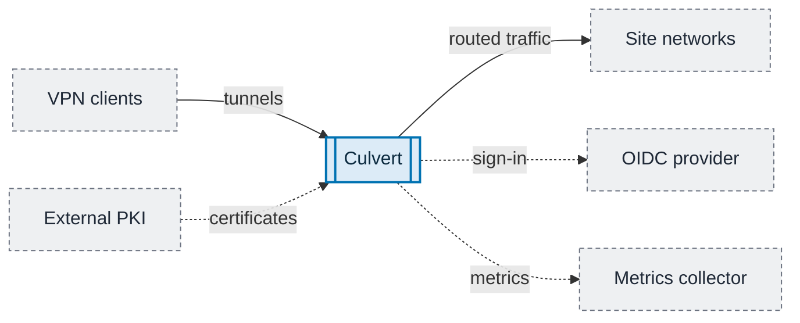
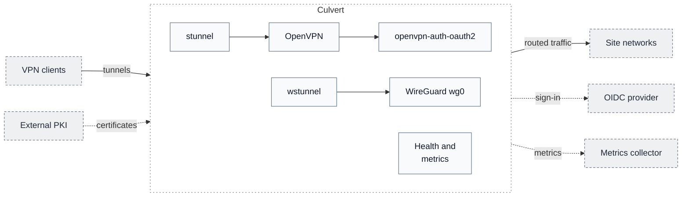
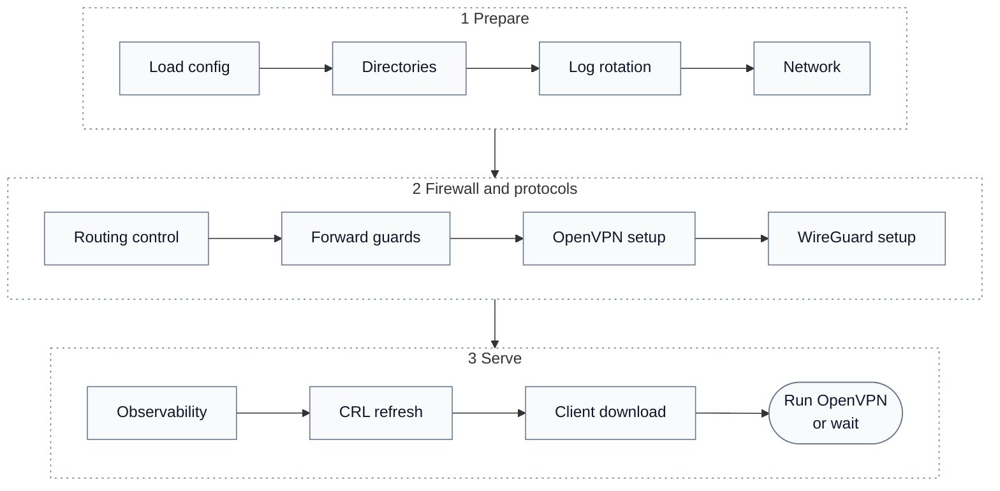

# Architecture

What culvert is made of, why it is one container instead of a stack, and the
invariants that no single file makes obvious. Look a fact up here before you
change the startup order, the firewall chains or the PKI paths.

A VPN server is easy to install and hard to keep correct. The usual answers
either mutate a host with a shell script, or ship a management plane, a
database and a web UI to configure one daemon. Culvert takes the other route:
one image, configuration by environment variable, and every capability past
plain OpenVPN over UDP an explicit opt-in. Upgrading is a `docker pull`.

That choice decides everything below. There is no state store, so a
replica is defined entirely by its environment and its mounted volumes. There
is no control plane, so the container itself has to refuse to start when a
control it was asked for did not install.

Diagram map:

- [L1 Context -- Culvert](#l1-context-and-l3-components)
  - [L3 Components -- Culvert](#l1-context-and-l3-components)
    - [L4 Detail -- Startup sequence](#one-entrypoint-one-ordered-sequence)
  - [L4 Detail -- Edge fleet traffic](use-case-edge-fleet.md#reverse-admin-and-cgnat-addressing)

## L1 context and L3 components

This diagram shows culvert as one box and what it talks to.

*Figure 1. L1 Context -- Culvert. Dashed boxes are external, and dotted arrows are opt-in.* Up: top of culvert. Down: [L3 Components -- Culvert](#l1-context-and-l3-components).

This diagram shows the processes inside the container.

*Figure 2. L3 Components -- Culvert. Dashed boxes are external, and dotted arrows are opt-in.* Up: [L1 Context -- Culvert](#l1-context-and-l3-components). Down: [L4 Detail -- Startup sequence](#one-entrypoint-one-ordered-sequence).

A client on an open network dials OpenVPN or WireGuard directly. Behind HTTPS-only egress it dials stunnel or wstunnel, which unwrap the TLS and hand the session on inside the container. Each process runs only when its switch is on:

| Process | Port | Runs when |
|---|---|---|
| OpenVPN | `1194/udp`, `1194/tcp` | `CULVERT_PROTOCOL` is `openvpn` (the default) or `both`. UDP runs while `CULVERT_UDP_ENABLED` is true (the default), TCP once `CULVERT_TCP_ENABLED=true` |
| stunnel | `443/tcp` | OpenVPN runs and `CULVERT_HTTPS_ENABLED=true` |
| openvpn-auth-oauth2 | `9000-9002/tcp` | One per enabled OpenVPN listener whose `CULVERT_OAUTH2_UDP_ENABLED`, `_HTTPS_ENABLED` or `_TCP_ENABLED` is true. Each defaults to `CULVERT_OAUTH2_ENABLED` |
| WireGuard `wg0` | `51820/udp` | `CULVERT_PROTOCOL` is `wireguard` or `both` |
| wstunnel | `4443/tcp` | WireGuard runs and `CULVERT_WG_HTTPS_TUNNEL_ENABLED=true` |
| Health and metrics | `9090/tcp` | Always, with `/metrics` once `CULVERT_METRICS_ENABLED=true` |

## What is in the image

The base is the Ubuntu image `BASE_IMAGE` pins by tag and digest in the `Dockerfile`. Every third-party binary comes
from upstream directly, and each arrives with its own verification:

| Component | Source | How it is verified |
|---|---|---|
| OpenVPN 2.7+ | The project's signed apt repo | Downloaded keyring must hold exactly one primary key, whose fingerprint is pinned. Installed version then checked against a floor |
| easy-rsa, iptables, wireguard-tools, stunnel4 | Ubuntu archive | apt, over the base image's trust |
| openvpn-auth-oauth2 | Pinned GitHub release `.deb` | SHA256 per architecture, checked before `dpkg` |
| wstunnel | Pinned GitHub release tarball | SHA256 per architecture, checked before extract |
| Python dependencies | `requirements-docker.txt`, exported from `uv.lock` | `pip --require-hashes`, so a drifted release fails the build |

Counting `pub` records rather than `fpr` records on the OpenVPN keyring is
deliberate. A key with signing subkeys emits one `fpr` line per subkey, all
legitimately the same primary, so counting fingerprints would reject a valid
key and counting keys catches a second one smuggled in alongside the real one.

The apt repo serves one version per suite and cannot be pinned, which is why
the version floor is asserted after install rather than requested before it.
The server config depends on 2.7 behaviour, so building on 2.6 would change it
silently: 2.7 deprecates `persist-key` on the server, and only 2.7 clients
reject an unknown pushed option, which is why `block-outside-dns` is not pushed. `openvpn-auth-oauth2` gets the artefact treatment instead because its
apt repo serves only the latest release and cannot be pinned at all.

DCO is supported but no kernel module ships in the image. Inside a container
DKMS would compile against kernel headers that are not there, and the module
has to be on the host regardless. OpenVPN 2.7 uses the `ovpn` module, in the
kernel from Linux 6.16 and built by ovpn-backports on older ones. Leaving it out
drops a compiler toolchain from the image at no cost to the capability.

## One entrypoint, one ordered sequence

`scripts/entrypoint.py` is a thin orchestrator. Every piece of real work lives
in a focused module under `scripts/lib/`, and the entrypoint's job is the
order.

This diagram shows the startup steps as three stages.

*Figure 3. L4 Detail -- Startup sequence. Read each stage left to right, then down.* Up: [L3 Components -- Culvert](#l1-context-and-l3-components).

The OpenVPN branch initialises PKI, renders the UDP, HTTPS and TCP server
configs from `config/*.template`, sets up stunnel, generates any auto-clients
and starts the OIDC helper. The WireGuard branch brings up `wg0` through
`wg-quick`, starts wstunnel and starts a connection monitor. `CULVERT_PROTOCOL`
selects one, the other, or both, and `both` runs both branches in full.

In WireGuard-only mode there is no OpenVPN process to block on, so the
entrypoint marks itself started and ready and waits on signals. The kernel
interface is already up at that point, which is why readiness flips there
rather than in the server starter.

## PKI: two modes, and local disk is the source of truth

Local mode has Easy-RSA generate a CA and a server certificate. External mode
fetches them through scalo secrets from a file mount, OpenBao or AWS Secrets
Manager. In both modes the files under the PKI directory are what OpenVPN
reads, and a remote provider is the update mechanism rather than the authority.
That is what lets an external deployment keep serving when the provider is
unreachable, on cached certificates, with a warning.

Three things here are not guessable from reading the code:

- `easyrsa init-pki` is never called. All it creates is three directories,
  and it insists on removing the PKI directory first, unconditionally on 3.2.x
  with no opt-out. The directory is a volume mount, so the removal fails
  outright, and where it could succeed it would take the CA and every
  certificate issued from it. 3.1.x's `init-pki soft` is not a portable
  substitute either, because 3.2.x reads that argument as a curve name.
  Culvert creates the directories itself, and `build-ca` still refuses to
  overwrite an existing CA, so a half-built PKI fails loudly instead of being
  replaced.
- The `tls-crypt-v2` server key is minted locally only when no provider
  supplies one. A client's key derives from it, so two servers with
  different keys reject each other's clients. Once
  `CULVERT_SECRETS_TC_KEY_PATH` is set, a failed fetch is fatal rather than a
  fall back to minting, because an install that comes up healthy and rejects
  clients at random is worse than one that refuses to start.
- CRL refresh differs by mode and cannot be shared. Local PKI regenerates
  from its own CA. External PKI has no CA key present, so the only way to pick
  up a revocation is to re-fetch. OpenVPN re-reads the CRL on every handshake,
  so a new file needs no reload. The server reloads only when the new CRL
  revokes a certificate the old one did not, to end that session before it
  renegotiates, and that reload drops every connected client.

A CRL that reaches its `nextUpdate` makes OpenVPN refuse every client,
including valid ones. The refresher therefore reports remaining life on every
cycle, not just whether the last refresh worked.

## Enforcement is two iptables chains, and the order matters

NAT and MSS clamping go in the base `FORWARD` and `POSTROUTING` paths.
Every policy rule lives in two dedicated chains, both rebuilt on each
start so restarts cannot stack duplicates:

- `CULVERT_FWD` -- opt-in routing control. Client isolation, the egress
  allow-list, and the downstream-admin gate that lets an operator initiate back
  into the tunnels.
- `CULVERT_GUARD` -- always on by default. Drops forwarded client traffic to
  link-local, which on a cloud instance is the metadata service and this host's
  credentials.

Four ordering rules hold this together, and each exists because the obvious
arrangement is wrong:

1. `CULVERT_GUARD` is installed AFTER `CULVERT_FWD`. Both insert at `FORWARD`
   position 1, so the last one installed is evaluated first, and the guard has
   to be. It is separate from routing control precisely because routing control
   is opt-in and the guard must hold on a default configuration.
2. `CULVERT_FWD` is detached from `FORWARD` before it is flushed, built
   completely, and jumped at last. A flushed chain that is still jumped falls
   through to the `FORWARD` policy, so there must be no window where it is
   jumped and empty.
3. Client-to-client rules sit above the conntrack accept, so cross-tunnel
   traffic is decided without reference to state and a RELATED packet cannot
   slip between clients.
4. Reverse-admin replies get a NAT `RETURN`, scoped to established flows only.
   Without it the general masquerade rewrites the client's reply to the
   server's own address and the exchange never completes. Scoping it keeps a
   client that initiates towards the admin range masqueraded.

Rules of this kind are not advisory, so a failed install raises and the
container exits. Serving clients while reporting a control that is not there is
the outcome being avoided. Chain creation and rule deletion stay tolerant,
because both are expected to fail on a normal restart.

The guard is scoped to `FORWARD` deliberately, which leaves the server's own
access to the metadata service intact -- external PKI on AWS authenticates with
exactly those instance credentials. The tunnels carry IPv4 only and only
`net.ipv4.ip_forward` is enabled, so there is no ip6tables setup at all.

## Observability is one listener

`CULVERT_METRICS_ADDR` (default `0.0.0.0:9090`) carries `/livez` and `/readyz`
always, and `/metrics` when metrics are enabled. OTLP is a push to a collector,
so it adds no listener. Health and metrics deliberately share the port so that
one published port covers the operator surface and nothing about it rides on
the VPN listeners.

## Deployment artefacts are generated, not authored

`deploy/deployment-contract.json` and the compose fragment are rendered from
culvert's scalo deployment contract by `scripts/generate-deploy-artefacts.py`.
Editing either by hand puts it out of step with the contract, and a unit test
compares the committed output against a fresh render. The release assembles the
Helm chart from the contract file on the scalo-service library chart, which
renders every contract field: the WireGuard port gate, the PKI claim, the root
identity, the capabilities and the single replica. The chart's `version` and
`appVersion` come from the release, so the chart and the image it deploys move
together. No chart is committed to this repository.

## Invariants, collected

- Configuration is `CULVERT_*` environment variables through scalo's cascade,
  with profile YAML as an extra source. Explicit env always beats a profile.
- `/etc/vpn` and `/var/log/vpn` are the canonical paths and nothing aliases
  them. No symlink points at the OpenVPN package's own directories: the package
  owns them as real directories, so a link lands inside one and the PKI no
  longer persists.
- Culvert runs as one replica. WireGuard mints its server key in the pod and
  the PKI volume is ReadWriteOnce, so the chart renders a singleton.
- Defaults are generic, never site-specific. Anything specific to one site belongs in a
  profile or the deployment values.
