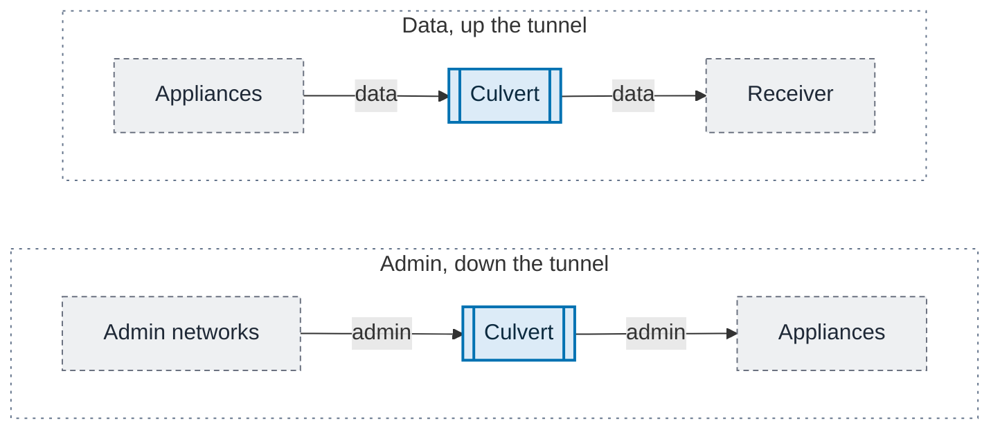

# Edge fleet -> receiver

An appliance fleet streaming data into a central receiver, with reverse
admin back down the same tunnels. The edge here is EdgeStream Hub: its
appliances push into the central ingest service, and operators need a way
back down to them. Any hub-and-spoke telemetry fleet looks the same. It is
the `edge-fleet` profile.

This is the deployment we run culvert in ourselves, which is why the profile
is opinionated rather than a blank template.

## Connecting an EdgeStream Hub appliance

EdgeStream Hub ships a VPN client, documented at
[System > VPN Client](https://hyperi-io.github.io/edgestream-hub/docs/operations/webui/system/vpn_client.html):
it takes a WireGuard `.conf` or an OpenVPN `.ovpn`, routes listed destination
CIDRs through the tunnel, and has a kill switch and auto-start. Culvert mints
that file. Data up, in order:

1. Run culvert with the `edge-fleet` profile and one client per appliance.
   The client files land in `/etc/vpn/clients`, and the download server hands
   them out with a bearer token ([use-case-home.md](use-case-home.md) shows
   it).
2. On the appliance, upload the client file under System > VPN Client, set
   Destination Routing to the receiver CIDR (the same value as
   `CULVERT_ALLOWED_DESTINATIONS`), and turn on the kill switch and auto-start.
   On an OpenVPN tunnel the routes the profile pushes take precedence over
   Destination Routing, so `push_routes` decides what goes down the tunnel.
3. Point a [destination](https://hyperi-io.github.io/edgestream-hub/docs/operations/webui/configuration/destinations/index.html)
   at dfe-receiver through the tunnel: the `vector` destination to the
   receiver's Vector-compatible gRPC listener, or the `http` destination to
   its `/ingest` endpoint. Both listeners are in the receiver's
   [architecture page](https://github.com/hyperi-io/dfe-receiver/blob/main/docs/architecture.md).

Admin down: culvert admits it from `CULVERT_DOWNSTREAM_ADMIN_CIDRS` (reverse
admin, below), and the appliance accepts administration over its tunnel. What DFE
does not give you is the way in: a bastion or proxy on the DFE operator
network with an address inside those admin CIDRs. Without one, administer
from a host that sits in them.

## Reverse admin and CGNAT addressing

Two things make this different from an ordinary client VPN. Understand
both before you deploy it.

Reverse admin comes first. A normal VPN lets clients initiate outbound and nothing more. This deployment
lets listed admin networks INITIATE back DOWN an established client
tunnel to reach an appliance - for updates, restricted repos, remote
support. That inbound-to-client path is deliberate and needed here, and it
is not something you want on a general-purpose VPN.

It is gated: the CIDRs in `CULVERT_DOWNSTREAM_ADMIN_CIDRS` are the sources
allowed to initiate inbound. Everything else unsolicited into the tunnels is
dropped.

In an edge fleet, data flows up from the appliances to the receiver, and admin traffic flows down from the admin networks to the appliances.



*Figure 1. L4 Detail -- Edge fleet traffic. Both flows ride the tunnels the appliances opened.* Up: [L1 Context -- Culvert](architecture.md#l1-context-and-l3-components).

CGNAT addressing is the second. Because the operator controls BOTH ends (the appliances and the
receiver), the tunnel is `100.64.0.0/24`, inside the `100.64.0.0/10` (RFC 6598,
carrier-grade NAT) range, instead of the default `10.8.0.0/22`. The appliances' LANs
and the destination network do not sit in `100.64/10`, so tunnel
addresses never collide with either end and no NAT gateway is needed just
to dodge overlap.

Do not use this preset for laptops on carrier or Starlink links. Those WANs
sit in `100.64/10`, as do Tailscale clients -
run a CGNAT tunnel on top of a CGNAT underlay and the transport
misroutes. The why is in [addressing.md](addressing.md). This is safe
here precisely because the operator owns both ends and knows the
appliances are not on CGNAT WANs.

## Routing control

`CULVERT_ROUTING_CONTROL_ENABLED=true` installs a dedicated FORWARD
filtering chain. With the `edge-fleet` profile it enforces:

- Replies always pass: established and related flows are accepted, so an
  appliance reaching the receiver still gets its answers back.
- Appliances cannot reach each other: `CULVERT_CLIENT_ISOLATION` is on,
  so client-to-client traffic is dropped.
- Appliances initiate to the receiver and nowhere else: `CULVERT_ALLOWED_DESTINATIONS`
  is the receiver CIDR, and clients may initiate to those destinations and no others.
  Pair it with `CULVERT_PUSH_ROUTES` so clients are routed at exactly what
  they are allowed to reach.
- Admin CIDRs alone may initiate inbound: `CULVERT_DOWNSTREAM_ADMIN_CIDRS`
  are the sources allowed to open connections down into the tunnels,
  and all other unsolicited inbound is dropped.

The profile ships example CIDRs - set them to yours:

```yaml
allowed_destinations: "10.20.0.0/16"          # the receiver network
downstream_admin_cidrs: "10.10.0.0/16"        # admin / bastion networks
push_routes: "10.20.0.0/16,10.10.0.0/16"      # receiver AND admin - see below
udp_network:  "100.64.0.0"                    # CGNAT tunnel subnet
udp_netmask:  "255.255.255.0"
```

`push_routes` covers both the receiver and the admin CIDRs. The receiver
route takes the appliance's outbound data. The admin route is what lets
an appliance's REPLY to an admin-initiated connection travel back UP the
tunnel instead of leaking out its default gateway. Omit the admin
CIDR and reverse admin fails one-way - the admin can send but never gets
a response.

Those are illustrative ranges, not live addresses. Substitute your
receiver, admin, and tunnel CIDRs.

## Deploying it

The profile sets `log_mode: stdout` for the cluster log pipeline and
starts on a local CA (external PKI - a fleet CA in OpenBao or a mounted
Secret - is typical here, so set `CULVERT_PKI_MODE=external` and
`CULVERT_SECRETS_*` to swap).

Client sharing stays at the shipped default, so give each appliance a
separate certificate. A copied certificate still connects when sharing is on, so revoke
a compromised one with `revoke-client`.

Run it on the Kubernetes chart - see
[use-case-kubernetes.md](use-case-kubernetes.md). The chart runs one replica,
so a single pod holds every appliance's client-IP allocation and certificate
state. Keep `publicService.externalTrafficPolicy: Local`, as the install
values there do, so the pod sees each appliance's original source address, which
per-client routing rules and the connection log need.

Related pages:

- [use-case-kubernetes.md](use-case-kubernetes.md) - the chart, the
  privileged namespace and the PKI volume
- [addressing.md](addressing.md) - why `100.64/10` here and why it is
  wrong for laptops
- [Routing Control in .env.example](../.env.example) - the exact
  `CULVERT_*` routing-control variables
